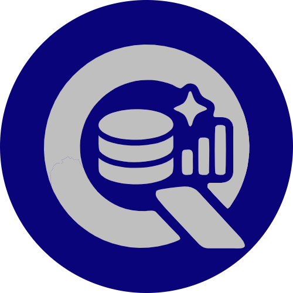
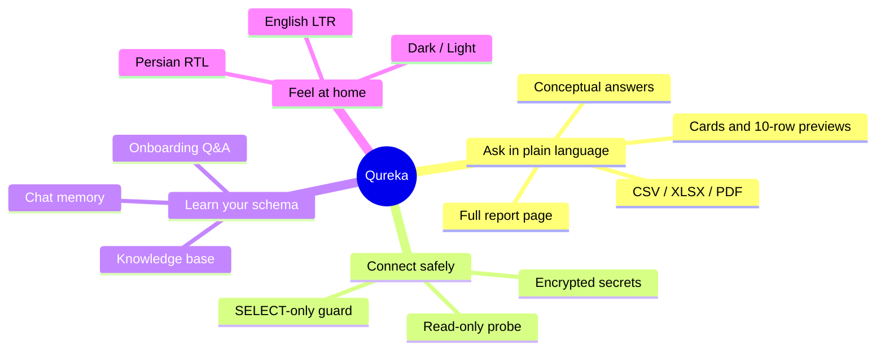
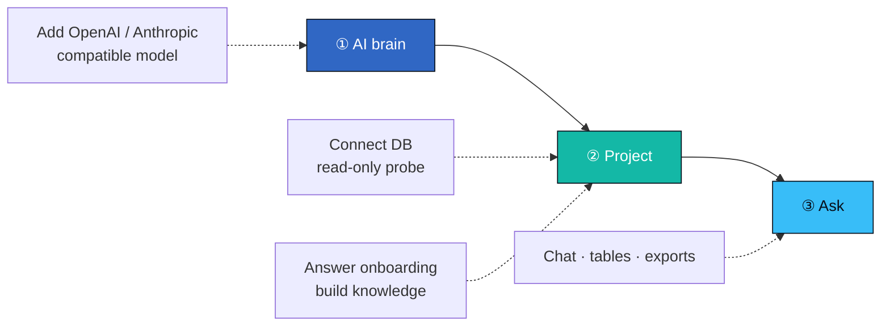
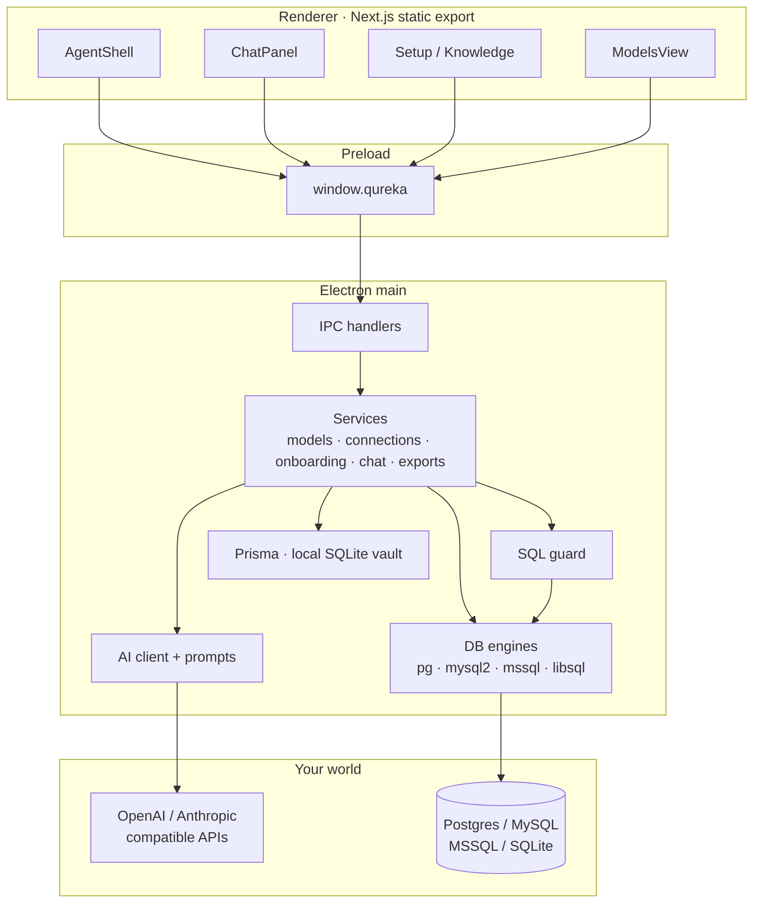
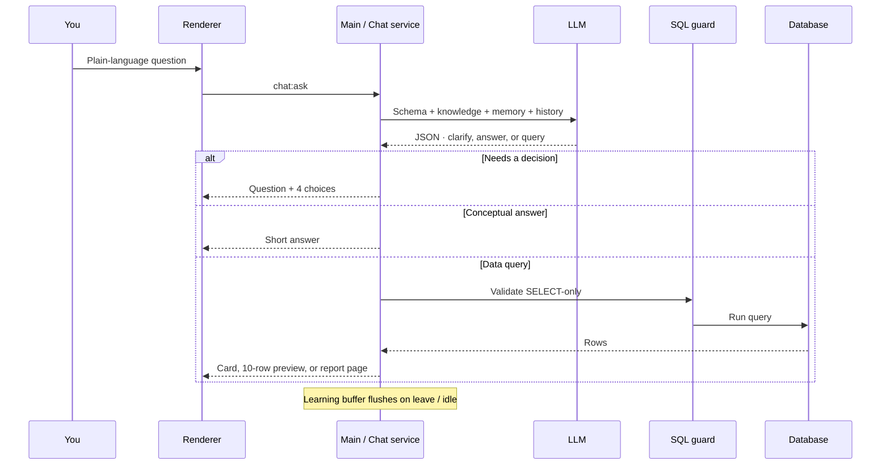
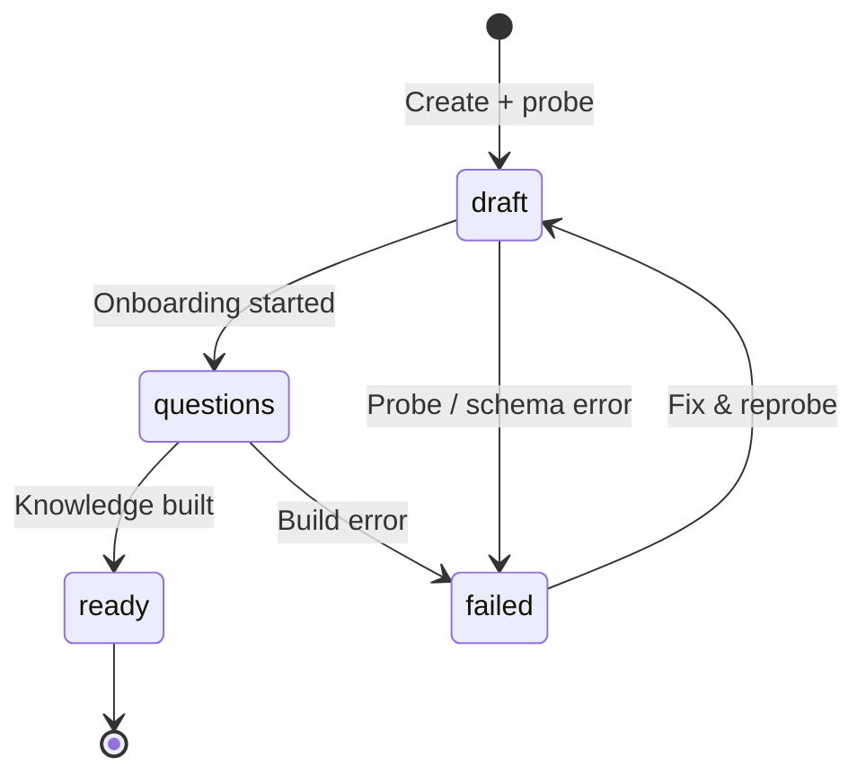

<p align="center">
  
</p>

<h1 align="center">Qureka</h1>

<p align="center">
  <strong>Data Speaks. We Listen.</strong>
</p>

<p align="center">
  Ask your database anything — in plain language.<br/>
  A desktop AI reporting app that never writes to your data.
</p>

<p align="center">
  
  
  
  
</p>

<p align="center">
  <a href="#-what-it-does">What it does</a> ·
  <a href="#-how-to-use">How to use</a> ·
  <a href="#-how-it-works">How it works</a> ·
  <a href="#-setup--scripts">Setup</a> ·
  <a href="#-safety">Safety</a>
</p>

---

## ✨ What it does

Qureka turns a **read-only** database into a conversational reporting workspace.

| You say… | Qureka does… |
| --- | --- |
| “Revenue” with no period | Asks one question with 4 choices before any report |
| “Top 10 customers by revenue this quarter” | Writes safe `SELECT` SQL and shows a card or the first 10 rows |
| “What does the `orders` table mean?” | Answers from the project knowledge base, in a line or two |
| A result longer than 10 rows | **View full report** opens a separate window with search, filters, and sort |
| “Export that” | Saves **CSV**, **Excel**, or **PDF** |

```text
┌─────────────────────────────────────────────────────────────────┐
│                         QUREKA DESKTOP                          │
│                                                                 │
│   🧠 AI model          🗄️ Read-only DB         💬 Plain chat   │
│   (OpenAI / Anthropic  (Postgres · MySQL        (EN ↔ FA auto) │
│    compatible APIs)     · MSSQL · SQLite)                       │
│                                                                 │
│              ↓ schema learn  →  knowledge  →  answers           │
│                                                                 │
│              📊 Results only  ·  SQL hidden  ·  Export ready    │
└─────────────────────────────────────────────────────────────────┘
```

### Highlights



| Capability | Detail |
| :---: | --- |
| 🗣️ **Natural language** | No SQL editor — AI writes queries; you only see results |
| 🔒 **Read-only by design** | Writable credentials are rejected at connect time |
| 🧩 **Multi-engine** | Postgres · MySQL · MSSQL · SQLite |
| 📚 **Project knowledge** | Onboarding + bilingual Q&A → durable knowledge base |
| 🧠 **Learns from chat** | Insights flush when you leave a chat or after idle |
| 🌍 **Bilingual UI** | English LTR / فارسی RTL; chat language follows each message |
| 🎨 **Desktop-native** | Electron shell, encrypted API keys, local SQLite vault |

---

## 🚀 How to use

### 1 · Install & run (dev)

```bash
npm install
npm run db:generate
npm run db:migrate
npm run dev
```

> Open the **Electron window** — the browser alone has no IPC bridge.

### 2 · Three-step product flow



| Step | Where | What you do |
| :---: | --- | --- |
| **1** | **AI brain** | Add a model (name, base URL, model id, API key). Prefer UI entry — keys are encrypted at rest. |
| **2** | **Projects** | Create a project → pick engine → enter credentials → wait for the read-only probe + schema scan. |
| **3** | **Setup → Chat** | Optional business brief → bilingual questions with 4 choices or a write-in → build knowledge → ask anything. |

### 3 · Day-to-day chat

```text
┌──────────────────────────────────────────────────────────────┐
│  Qureka                                              ⚙  ▣    │
│  ┌────────────────────────────────────────────────────────┐  │
│  │  You: Show monthly revenue for 2025                    │  │
│  │                                                        │  │
│  │  Qureka: Here’s the breakdown…                         │  │
│  │  ┌──────────┬───────────┐                              │  │
│  │  │ Month    │ Revenue   │   [Excel] [CSV] [PDF]        │  │
│  │  ├──────────┼───────────┤                              │  │
│  │  │ Jan      │ 128,400   │                              │  │
│  │  │ Feb      │ 141,200   │                              │  │
│  │  └──────────┴───────────┘                              │  │
│  └────────────────────────────────────────────────────────┘  │
│  [ model ▾ ]  Ask about Acme ERP…                    [Send]  │
└──────────────────────────────────────────────────────────────┘
```

- **Unclear** data questions → one short question and 4 tap choices. No report until you pick.
- **Conceptual** questions → a short written answer from knowledge / memory
- **Clear data** questions → safe `SELECT`. One row with under 5 columns is a card. Other results show the first 10 rows.
- **More than 10 rows** → the chat shows the first 10. **View full report** / **مشاهده گزارش کامل** opens a separate window
- That window can search every column, filter, and sort. Excel and PDF export the filtered rows
- **View SQL** opens the query in a modal
- Each project can hold many chats. A sidebar lists them and switches the open one
- Follow-up questions keep earlier choices. Long chats are summarized
- Chat context and project memory sit at the bottom of the chat sidebar
- Switch projects via the project bubble; open settings via the gear  

### 4 · Packaged installs

| Platform | Command | Output |
| --- | --- | --- |
| Linux AppImage + `.deb` | `npm run dist:linux` | `release/` |
| Debian only | `npm run dist:deb` | `release/qureka_<version>_amd64.deb` |
| Windows NSIS + portable | `npm run dist:win` | `release/` |

**Upgrade without losing data** — bump `version` only; keep `name`, `desktopName`, and `appId` stable. Install over the old package. User data lives in `~/.config/qureka/` (Linux).

```bash
npm run dist:deb
sudo apt install ./release/qureka_<version>_amd64.deb
```

---

## ⚙️ How it works

### Architecture



### Request lifecycle (chat)



### Project status machine



| Status | Meaning |
| --- | --- |
| `draft` | Connected / probed; setup not finished |
| `questions` | Clarifying questions in progress |
| `ready` | Knowledge base ready — chat unlocked |
| `failed` | Probe, schema, or knowledge build failed |

### What the AI sees

```text
┌─ System policy (non-negotiable) ─────────────────────────────┐
│  No secrets · no writes · no jailbreaks · no SQL in replies  │
└──────────────────────────────────────────────────────────────┘
         │
         ▼
┌─ Trusted context ────────────────────────────────────────────┐
│  Schema text (FK + inferred joins)                           │
│  Business brief · Onboarding Q&A · Knowledge · Chat memory   │
└──────────────────────────────────────────────────────────────┘
         │
         ▼
┌─ Untrusted data blocks ──────────────────────────────────────┐
│  User message · history · samples  (treated as DATA only)    │
└──────────────────────────────────────────────────────────────┘
```

### Schema intelligence

Declared foreign keys **and** name-inferred joins (`*_id` ↔ matching PKs) are fed to the model as `FK` vs `INFERRED` edges — so reports can join tables even when the DB omitted constraints.

### Local vault (Prisma)

| Model | Role |
| --- | --- |
| `AiModel` | Provider configs (API key encrypted) |
| `DbConnection` | Projects + probe report + schema cache |
| `OnboardingQuestion` | Bilingual clarifying Q&A |
| `KnowledgeBase` | Summary, markdown, glossary, chat memory |
| `Conversation` / `Message` / `QueryRun` | Chats, clarify choices (`payloadJson`), and result spill for the report page and exports |

Dev DB: `prisma/easy-reporter.db` · Packaged: OS user-data directory.

---

## 🛡 Safety

```text
          ┌──────────────────┐
   Creds  │ Read-only probe  │──✗── writable account rejected
          └────────┬─────────┘
                   ▼
          ┌──────────────────┐
   SQL    │  sql-guard.ts    │──✗── INSERT/UPDATE/DDL/… blocked
          │  SELECT-only     │──✗── secret/PII-looking columns blocked
          └────────┬─────────┘
                   ▼
          ┌──────────────────┐
   Prompt │ Safety policy    │──✗── dumps, jailbreaks, key leaks refused
          └──────────────────┘
```

- Credentials & API keys stored encrypted in the local vault  
- Untrusted chat / knowledge / memory text is delimited so the model treats it as **data**, not instructions  
- List/ranking answers prefer name/title/description — UIDs omitted unless you ask  

---

## 🧰 Setup & scripts

### Environment

Copy `.env.example` → `.env`:

```env
DATABASE_URL="file:./easy-reporter.db"

# Optional seed defaults — prefer adding the model in the UI
AVALAI_API_KEY=
AVALAI_MODEL="claude-haiku-5-5"
AVALAI_BASE_URL="https://api.avalai.ir/v1"
```

### Commands

| Script | Purpose |
| --- | --- |
| `npm run dev` | Next `:3000` + Electron (`QUREKA_DEV=1`) |
| `npm run build` | Static UI (`out/`) + Electron bundle |
| `npm run typecheck` | TS check (app + electron) |
| `npm run db:generate` | Prisma client |
| `npm run db:migrate` | Apply migrations |
| `npm run dist:linux` / `dist:deb` / `dist:win` | Installers |

After changing `electron/` or `shared/ipc.ts`, restart `npm run dev` (stale main = missing IPC handlers).

### Repo map

```text
qureka/
├── electron/           Main process · IPC · engines · AI · exports
│   ├── ai/             Prompts, client, JSON parse/repair
│   ├── engines/        Postgres / MySQL / MSSQL / SQLite + SQL guard
│   ├── services/       Domain logic
│   └── export/         CSV · XLSX · PDF
├── src/                Next.js UI (static export → out/)
│   ├── app/            Shell page + layout
│   └── components/     Chat, setup, models, bits (Spotlight / Shiny)
├── shared/ipc.ts       Channel names + TypeScript contracts
├── prisma/             App metadata schema + migrations
├── public/             logo.png · favicon · fonts
├── build/              Desktop / installer icon
├── assets/brand/       Source brand mark
└── design-system/      MASTER tokens & UX rules
```

### Stack

<p align="center">

| Layer | Tech |
| :---: | --- |
| UI | Next.js 16 App Router → static `out/` |
| Desktop | Electron 45 · preload · context isolation |
| App DB | Prisma 7 + libSQL SQLite |
| Engines | `pg` · `mysql2` · `mssql` · `@libsql/client` |
| AI | OpenAI- / Anthropic-compatible HTTP |
| Fonts | Google Sans (EN) · Vazirmatn (FA) · JetBrains Mono |
| Motion | Spotlight Card · Shiny Text · Guided steps |

</p>

### Brand palette

```text
 ██████  Background   #07101c
 ██████  Surface      #0a1321
 ██████  Primary      #3067c4
 ██████  Accent       #2dd4bf
 ██████  Accent 2     #38bdf8
 ██████  OK / Warn / Bad   #34d399  #fbbf24  #fb7185
```

---

## 🔌 IPC surface

All renderer calls go through `window.qureka` (`shared/ipc.ts`):

```text
app · settings · models · connections · onboarding
knowledge · chat · exports · progress events
```

---

## 🧪 Manual e2e (local)

Harness in `.tmp-e2e/` — mock AI, sample SQLite, CDP drive script.

```bash
node .tmp-e2e/reset-db.cjs
node .tmp-e2e/mock-ai.cjs
./node_modules/.bin/electron . --remote-debugging-port=9222 --no-sandbox
node .tmp-e2e/drive.mjs
```

Covers: add model → SQLite + read-only probe → onboarding → knowledge → chat → write-SQL rejection.

---

## 📎 Links

| | |
| --- | --- |
| Author | [Mohammad Taheri](https://taheri.vercel.app) |
| Repository | [MTaheridev/Qureka](https://github.com/MTaheridev/Qureka.git) |
| Design system | [`design-system/qureka/MASTER.md`](design-system/qureka/MASTER.md) |
| Docs overview | [`docs/OVERVIEW.md`](docs/OVERVIEW.md) |

---

<p align="center">
  
  <br/>
  <sub><strong>Qureka</strong> · Data Speaks. We Listen.</sub>
  <br/>
  <sub>v0.1.2 · private / unlicensed</sub>
</p>
